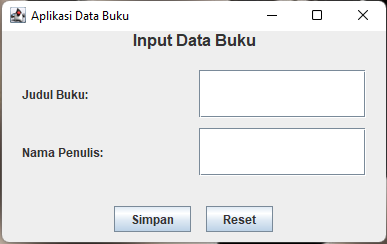

# Aplikasi Data Buku (Java Swing GUI)

## Identitas

- **Nama**: Sovia Rovana Fikri
- **NIM**: F1D02510027

---

Tugas **3B - Latihan/Eksplorasi Materi Graphical User Interface pada Java**.

Aplikasi sederhana untuk menginput data buku (judul dan nama penulis) menggunakan Java Swing. Program ini dibuat untuk mengeksplorasi komponen-komponen utama GUI di Java.

## Screenshot

## Fitur

- Input **Judul Buku** dan **Nama Penulis**
- Tombol **Simpan**: menampilkan data di console dan memunculkan dialog konfirmasi. Jika ada kolom yang kosong, muncul pesan peringatan.
- Tombol **Reset**: mengosongkan semua kolom input

## 5 Komponen Utama GUI yang Digunakan

### 1. Top-Level Container: JFrame

Jendela utama aplikasi. Semua komponen lain diletakkan di dalam JFrame. Class DataBuku mewarisi (extends) JFrame.

### 2. Intermediate Container: JPanel

Wadah perantara untuk mengelompokkan komponen di dalam JFrame. Ada 2 panel:

| Panel | Fungsi |
|---|---|
| formPanel | Menampung label dan kolom input |
| buttonPanel | Menampung tombol Simpan dan Reset |

### 3. Atomic Component: JLabel, JTextField, JButton

Komponen dasar yang berinteraksi langsung dengan pengguna.

| Class | Fungsi |
|---|---|
| JLabel | Menampilkan teks (judul header dan label kolom) |
| JTextField | Kolom input judul buku dan nama penulis |
| JButton | Tombol Simpan dan Reset |

### 4. Layout Classes: BorderLayout, GridLayout, FlowLayout

Mengatur posisi dan ukuran komponen di dalam container.

| Layout | Dipakai pada | Keterangan |
|---|---|---|
| BorderLayout | JFrame | Header di bagian atas, form di tengah, tombol di bagian bawah |
| GridLayout | formPanel | Susunan grid 2 baris x 2 kolom untuk label dan input |
| FlowLayout | buttonPanel | Tombol tersusun sejajar di tengah |

### 5. Event Listener: ActionListener

Menangani aksi klik tombol. Class DataBuku mengimplementasikan interface ActionListener dan meng-override method actionPerformed(). Method ini memeriksa tombol mana yang diklik: tombol Simpan memproses dan menampilkan data, sedangkan tombol Reset mengosongkan kolom input. Listener didaftarkan ke kedua tombol menggunakan addActionListener.

## Isi Repositori

- DataBuku.java : kode program
- README.md : dokumentasi ini
- Screenshoot.png : tampilan aplikasi
